# Tiny Eye, Phase 0: do tiny doodle neurons have one main job?

*2026-10-30. The offline go/no-go measurement from [plans/tiny-eye.md](../../plans/tiny-eye.md), after Goodfire's essay [Neural Networks Are Already Clean](https://already-clean.goodfire.com/). Labels and scores came from **gpt-6-luna**: the key can't use gpt-6.1-luna (`GET /v1/models/gpt-6.1-luna` answered 404 at start-up), so the labeler fell back to gpt-6-luna, as planned.*

## Verdict

**The gate as written fails on one of its four lines: squeezing does not make the neurons score lower.** The other three pass, one narrowly.

My recommendation is still **go, with the room's copy adjusted**. The squeeze result matches the essay's own finding: a squeezed layer's neurons get coarser, not muddled. Our distractor test can't see "coarser", but a breadth measure can (see The squeeze).

| Gate | Needed | Result | |
|---|---|---|---|
| Accuracy of the chosen size (eye80k, 83k parameters) | 85% or better on 24 classes | **88.3%** held-out | pass |
| Last-stage neuron poles that pass the distractor test | at least 60% | **62.5%** (80 of 128; 95% interval 54–70%). Re-scoring 64 of these poles on fresh drawings gave 61%, then 64%. | pass, narrowly |
| A handful of neurons with a visible growth story | a handful | **Yes.** Many narrow from a shape to a thing (top-heavy shapes → trees), some switch jobs (castle walls → fish), and a few grow offshoots just below their top 8 (house roofs → umbrellas) | pass |
| The squeezed variant scores clearly lower | clearly lower | **No.** sq8 (whole last stage cut to 8 channels): 62.5%, 10 of 16, the same as eye80k. sqmlp8 (last MLP cut to 8, wide bypass kept): 81%, 13 of 16. The sq8 neurons are measurably broader, though. | **fail** |

What changes for the room:

- **Clean, but not as clean as the essay's big models.** A vision model calls about 87% of poles "one main job". About 61% survive a strict test. Pure one-class poles pass about 90% of the time. Poles that hold a shape idea spread across classes ("two tall points": cat ears and castle towers) pass less often: some are clean but hard to name in 8 words, and some really are mixed.
- **No "bigger is cleaner" in this range.** The pass rate is flat across 23k, 83k and 311k parameters (59%, 62%, 61%). The essay's smallest ConvNeXt (92k) sits in this range, and the essay calls its neurons coarse. The room shouldn't claim that bigger eyes are cleaner; these eyes don't show it. Two bigger eyes trained later (1.2M and 3.5M parameters) are no cleaner either, though they are 3 points more accurate than eye80k (see Bigger eyes).
- **Growth looks like narrowing and job swaps more than offshoots.** Neurons settle late. At 85% accuracy (about a third of the way through training) a neuron's final top-100 drawings are only 40% in place. The scrubber will show jobs forming, narrowing, and sometimes switching. The essay's "an early job keeps growing offshoots" shows clearly in only a few neurons.
- **Squeezing makes neurons coarser, not muddled.** With no wide bypass (sq8), each of the 8 neurons strongly answers to more kinds of thing: 4.4 classes, against 3.25 for eye80k's neurons. A random 8 of eye80k's neurons reaches that 0.1% of the time. For example, one sq8 neuron covers rainbows, umbrellas and castles ("an arch on top"). Still, each neuron's top 16 stay one nameable idea, so labels pass as often as before. With the wide bypass kept (sqmlp8), the 8 neurons just become crisp class detectors. The room's pressure lesson should show breadth, not muddle.

## What was built

**Data.** The 24 Quick, Draw! categories from the plan: dragon, teapot, cloud, moon, castle, cat, dog, fish, bird, rabbit, frog, owl, sheep, tree, flower, house, sun, star, apple, rainbow, snowman, umbrella, ambulance, police car.
- 10,000 training and 1,000 held-out drawings each (240,000 and 24,000), as 28×28 bitmaps.
- Each category file (100–340k drawings) was read with HTTP range requests: 11 evenly spaced chunks of 1,000 rows, then shuffled and split. That is about 9 MB per category, not the whole file.
- The bitmaps include drawings the game didn't recognize, so some are hard even for people.
- The held-out set is split into half A (12,000 drawings, used to find each neuron's examples) and half B (12,000, used only for scoring).
- Quick, Draw! data: made available by Google, Inc. under the Creative Commons Attribution 4.0 International license.

**Models** ([tools/eye/train.py](../../tools/eye/train.py)). The plan's tiny ConvNeXt-style net:
- 2×2 patchify stem → 3 stages, each one block of [7×7 depthwise conv → LayerNorm → pointwise MLP with 4× hidden channels → residual] → average pool → LayerNorm → linear.
- The stages see 14×14, 7×7 and 4×4 grids.
- **Neurons** are the MLP hidden channels, read before the GELU (the summed votes, so each has a positive and a negative pole). A drawing's value for a neuron is its mean over the grid.
- Training: 20 epochs, AdamW (learning rate 3e-3, weight decay 0.05, warmup then cosine), batch 512, label smoothing 0.1, small random rotations, scalings and shifts.
- **20 snapshots** per run, log-spaced (steps 0, 20, 28, … 6652, 9360), so the early growth is visible.

| Run | Widths per stage | Parameters | Last-stage neurons | Held-out accuracy | Training time (shared GPU) |
|---|---|---:|---:|---:|---:|
| eye20k | 12, 24, 32 | 23,188 | 128 | 84.9% | 8 min |
| **eye80k** (chosen) | 24, 48, 64 | 82,704 | 256 | **88.3%** | 27 min |
| eye300k | 48, 96, 128 | 310,792 | 512 | 90.3% | 43 min |
| eye80k-sq8 | 24, 48, **8**; last MLP **8** | 34,528 | 8 | 83.8% | 31 min |
| eye80k-sqmlp8 | 24, 48, 64; last MLP **8** | 50,712 | 8 | 87.0% | 28 min |

The two squeezes cut eye80k's last stage to 8 neurons in two ways:
- **sq8** narrows the whole stage to 8 channels. Everything the classifier sees must pass through 8 numbers, with no wide bypass, like the essay's InceptionV1 layer cut from 480 to 10 channels.
- **sqmlp8** keeps the 64-wide residual stream and narrows only the last MLP to 8 neurons.

eye80k's most confused pairs are ambulance/police car (180 of 2,000 drawings), dragon/bird (148) and cat/dog (115). Its weakest classes are frog (64%), bird (70%) and dog (73%).

**Measurement** ([tools/eye/probe.py](../../tools/eye/probe.py), [tools/eye/label.py](../../tools/eye/label.py)):

1. **Examples.** For each last-stage neuron, its top-16 and bottom-16 drawings in half A.
2. **Label.** One call per neuron shows gpt-6-luna both grids side by side. The model gets no class names in the picture, only the list of the 24 kinds in the prompt. It returns a label of at most 8 words per pole and a judgment for each: "one" main job, "two" related jobs, "mixed", or "unclear".
3. **Score (the distractor test).** One call per pole shows only that label and 16 numbered drawings from half B: 4 drawn at random from the pole's top-16 in B, and 12 random drawings from outside its top-200. The model must pick the 4. A pole **passes with 3 or 4 right**; guessing passes 2.7% of the time.
4. **Sample.** 64 random neurons (128 poles) for each of the three sizes; all 8 neurons for each squeeze.
5. **Growth.** For every last-stage neuron, its top-100 drawings in half A at all 20 snapshots, sorted into rough stories by class shares. 8 picked neurons got a vision label for each of 5 snapshots.
6. **Retest.** For eye80k, the first 32 sampled neurons (64 poles) were scored a second time on a fresh random draw, to see how noisy one trial is.

**Labeling cost:** 696 calls in total (cap 1,000), with no failed or retried calls. That is 294,757 prompt tokens and 570,288 completion tokens, of which 544,323 were reasoning.

Here is what the labeler sees for eye80k neuron 85 (it labeled the left side "Things with two tall points sticking up" and the right side "Trees with leafy tops and trunks"):

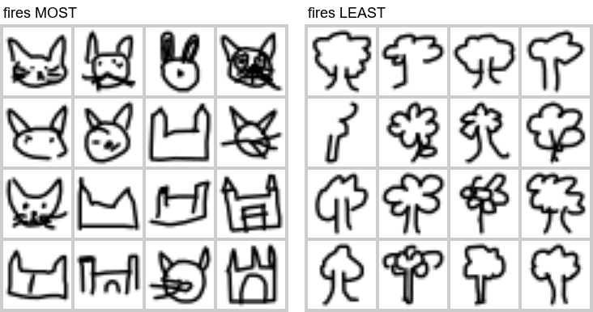

And one scoring trial: the label "Small, sideways shapes with bumps or points" (eye80k neuron 246, its "fires least" side). The true four are 3, 7, 10 and 15. The scorer picked 2, 6, 9 and 11 (wide vehicles and a castle), so 0 of 4. The label was too vague, not the neuron: see its card below.

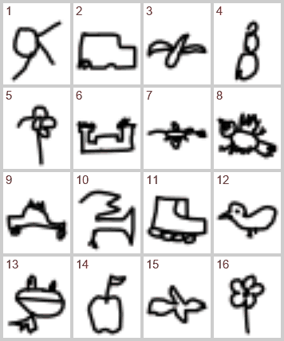

## How clean are the neurons?

Distractor test, last stage, 64 random neurons per size (95% Wilson intervals):

| Run | Poles | **Pass** | "Fires most" pass | "Fires least" pass | Mean right of 4 | Labeler's judgment: one / two / mixed / unclear |
|---|---:|---|---|---|---:|---|
| eye20k | 128 | 76 = **59%** (51–67%) | 40/64 = 62% | 36/64 = 56% | 2.70 | 110 / 5 / 13 / 0 |
| **eye80k** | 128 | 80 = **62%** (54–70%) | 45/64 = 70% | 35/64 = 55% | 2.70 | 109 / 6 / 13 / 0 |
| eye300k | 128 | 78 = **61%** (52–69%) | 46/64 = 72% | 32/64 = 50% | 2.69 | 115 / 3 / 10 / 0 |
| eye80k-sq8 | 16 | 10 = **62%** (39–82%) | 6/8 | 4/8 | 2.62 | 14 / 1 / 1 / 0 |
| eye80k-sqmlp8 | 16 | 13 = **81%** (57–93%) | 8/8 | 5/8 | 3.12 | 12 / 1 / 3 / 0 |

- **Neurons, not poles.** In eye80k, 23 of 64 neurons pass on both poles and 57 of 64 pass on at least one. eye20k: 22 and 54; eye300k: 23 and 55.
- **The "fires most" side is cleaner than the "fires least" side**, especially in the bigger nets (70–72% against 50–55%). Still, about half of all negative poles carry a job a label can find. Some neurons' clearest job is their negative pole (cards for neurons 14 and 201 below).
- **One trial is noisy; the rate is not.** In the eye80k retest, 48 of 64 poles got the same verdict twice, and the pass rate moved from 61% to 64%. Read a single card's pass/fail loosely, and the counts with more trust.
- **Pure poles pass and spread poles mostly don't.** A pole whose 16 drawings are 12 or more from one class passes 88–95% of the time: eye20k 36/41, eye80k 32/35, eye300k 39/41. A pole spread over many classes (under 8 of 16 from one class) passes 35–42%: 20/50, 20/48, 17/49. Spread poles are where shape jobs live: "lines sticking out" (suns, and animals' legs), "two tall points" (cat ears and castle towers), "crossed loops" (fish), "round body with bumps" (frogs and teapots). Some of these pass. The ones that fail are partly mixed, and partly too hard to name in 8 words.
- **Labeler limits.** gpt-6-luna sometimes misreads 28×28 doodles. It called 16 owls "cats sitting upright" (the scorer still found them), 12 snowmen "round fruit with stems", and 11 flat dragon scribbles "small, sideways shapes with bumps or points" (0/4). Some failures are the labeler's, not the neuron's, so 61% is a floor on how clean these neurons are, not a ceiling.

Class purity, which needs no API: the share of a pole's 16 drawings that come from its most common class, over **all** neurons in every stage. It can't see shape jobs, so it reads clean shape neurons as mixed.

| Run | Stage 1 (14×14) | Stage 2 (7×7) | Stage 3 (4×4, the last) | Last-stage poles ≥75% pure | Last-stage poles ≥50% pure |
|---|---:|---:|---:|---:|---:|
| eye20k | 0.37 | 0.42 | 0.59 | 35% | 61% |
| eye80k | 0.33 | 0.44 | 0.58 | 32% | 61% |
| eye300k | 0.35 | 0.44 | 0.60 | 33% | 62% |
| eye80k-sq8 | 0.34 | 0.45 | 0.66 | 38% | 75% |
| eye80k-sqmlp8 | 0.35 | 0.48 | 0.69 | 56% | 75% |

Purity rises from stage to stage, as expected: early stages see strokes and corners, and the last stage sees things. It is flat across sizes, like the distractor test.

## The squeeze

Both squeezes cut eye80k's last stage from 256 neurons to 8.

| Run | Accuracy | Poles that pass | Effective classes in the top 16 / 100 / 500 ("fires most") | Classes a neuron strongly answers to |
|---|---:|---|---|---:|
| eye80k | 88.3% | 80/128 = 62% | 3.1 / 4.6 / 7.1 | 3.25 |
| eye80k-sq8 (8 channels, no wide bypass) | 83.8% | 10/16 = 62% | 2.1 / 3.1 / 5.3 | **4.38** |
| eye80k-sqmlp8 (8 MLP neurons, 64-wide bypass) | 87.0% | 13/16 = 81% | 1.9 / 2.8 / 4.1 | 3.12 |
| eye20k / eye300k, for scale | 84.9% / 90.3% | 59% / 61% | 3.2 / 5.0 / 7.7 and 2.9 / 4.5 / 7.1 | – |

How the columns are measured ([tools/eye/breadth.py](../../tools/eye/breadth.py)):
- **Effective classes:** e to the entropy of the class shares in a pole's top-k drawings, from half A. 1.0 means one class.
- **Classes a neuron strongly answers to:** how many classes have a mean value more than one standard deviation above or below the neuron's overall mean. This looks at every drawing, not just the extreme tip.

What happened:

- **The distractor test does not drop.** With only 8 neurons, each neuron's extreme tip is purer than before (2.1 effective classes in the top 16, against 3.1), so labels are easy to write and to check. A test built on the top 16 can't see pressure.
- **Without the bypass, the neurons get coarser.** In sq8, everything the classifier sees passes through 8 numbers. Each neuron strongly answers to 4.4 classes, against 3.25 for eye80k's neurons; a random 8 of eye80k's neurons gets that broad only 0.1% of the time. This is the essay's InceptionV1 result, where ten curve detectors became one broad curves-and-loops neuron, at doodle scale. Neuron 7 below is an "arch on top" neuron: its top 16 are rainbows, but umbrellas and castles answer almost as strongly (class scores 2.3, 2.0 and 1.6 standard deviations above its mean). In eye80k, rainbows, umbrellas and castles each have neurons of their own.
- **With the bypass kept, there's no real pressure.** sqmlp8 keeps 87% accuracy with 8 neurons. They became crisp class detectors: cats, trees, castles, rabbits, flowers, emergency vehicles, birds. They patch a few classes on top of what the 64-wide residual stream already carries. A squeeze has to block the bypass to squeeze anything.
- **Small samples.** Each squeeze has only 16 poles (intervals 39–82% and 57–93%), but the breadth difference is well beyond chance.

All 8 sq8 neurons. Labels are gpt-6-luna's, with the scorer's hits out of 4. "Answers to" lists the classes 1 standard deviation or more above (+) or below (−) the neuron's mean.

| Neuron | Fires most | Fires least | Answers to |
|---:|---|---|---|
| 0 | "Small houses with pointed roofs" (4) | "Fluffy wide tops with little lines hanging below" (1) | + house, snowman, apple; − sheep, cloud |
| 1 | "Complete shapes with dark details" (2) | "Open, curved strokes and partial shapes" (2) | + star, owl; − cloud, rainbow |
| 2 | "Crescent shapes like moons" (3) | "Pointy shapes with tips or spikes" (3) | + moon, rainbow; − castle, ambulance, sun |
| 3 | "Pointy ears or peaked roofs" (3) | "Simple rounded shapes with little detail" (0) | + house, umbrella, castle, cat |
| 4 | "Castles with tall towers and notched walls" (3) | "Mostly round suns with short rays around them" (3) | + castle, umbrella; − sun, snowman |
| 5 | "Suns with rays around them" (4) | "Umbrellas with curved tops and handles" (4) | + sun, snowman, apple; − umbrella, castle, rainbow |
| 6 | "Animals with bumpy, rounded outlines" (1) | "Tall straight sides with arches or square tops" (4) | + owl, dog; − rainbow, castle, apple |
| 7 | "parallel upside-down U-shaped curved lines" (4) | "cute little animals with ears and faces" (1) | + rainbow, umbrella, castle |

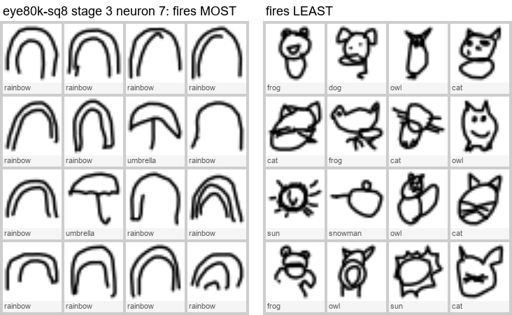

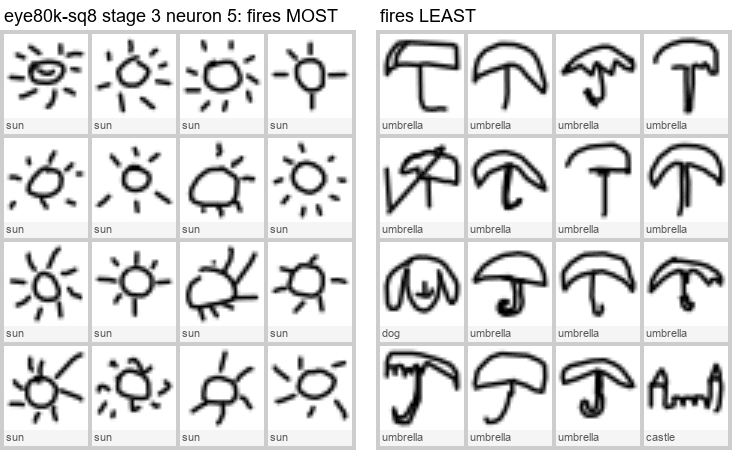

**For the room:** show the squeeze with a "what kinds of things make it fire" bar (class means over the sample set) next to the top-16 grid. The squeezed neuron's bars spread over more kinds of thing, even when its top 16 look tidy.

## Neuron cards (eye80k, last stage)

Each card shows a neuron's 16 top and 16 bottom held-out drawings, with class names (the labeler never saw the class names). The quoted text is gpt-6-luna's label, followed by how many of 4 the scorer found from it.

**Neuron 6: houses.** "Simple houses with pointed roofs" (4/4). Its other side: "Tiny, scattered marks with lots of empty space" (1/4). A textbook one-class positive pole with a vague negative pole.

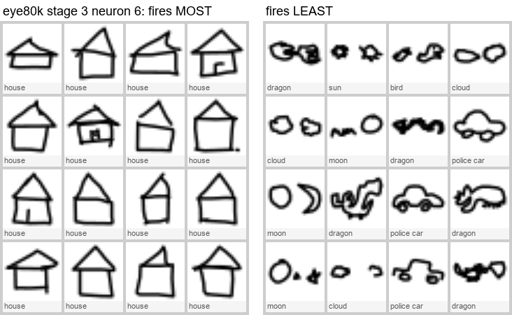

**Neuron 85: two tall points.** "Things with two tall points sticking up" (3/4): cat ears, rabbit ears and castle towers. Its other side: "Trees with leafy tops and trunks" (3/4). A shape job that crosses classes, with a clean opposite.

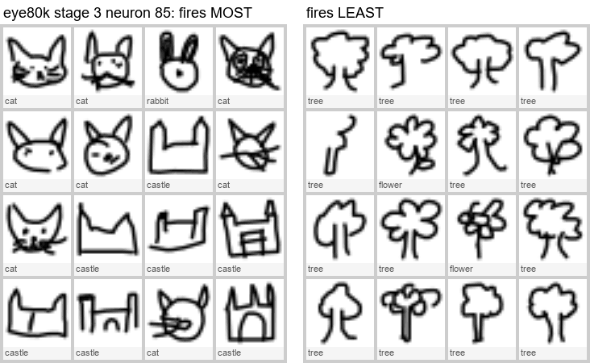

**Neuron 118: lines sticking out.** "Wide shapes with many lines sticking out" (3/4): sun rays and four-legged animals' legs. Its other side: "Tall shapes with wide tops and narrow stems" (2/4).

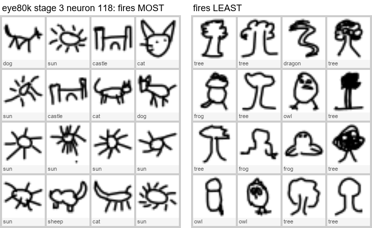

**Neuron 0: a top on a stem.** "A wide rounded top above a thin stem" (4/4): trees and umbrellas. Its other side: "Cats with pointy ears and whiskers" (3/4).

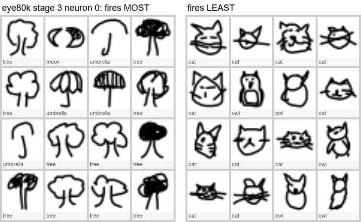

**Neuron 14: the clean job is the negative one.** "Busy, irregular drawings with many dark parts" (0/4). Its other side: "Crossed loops, like bow ties or sideways eights" (4/4): fish drawn as one crossing stroke, plus A-shaped houses. This is the essay's "the negative pole matters".

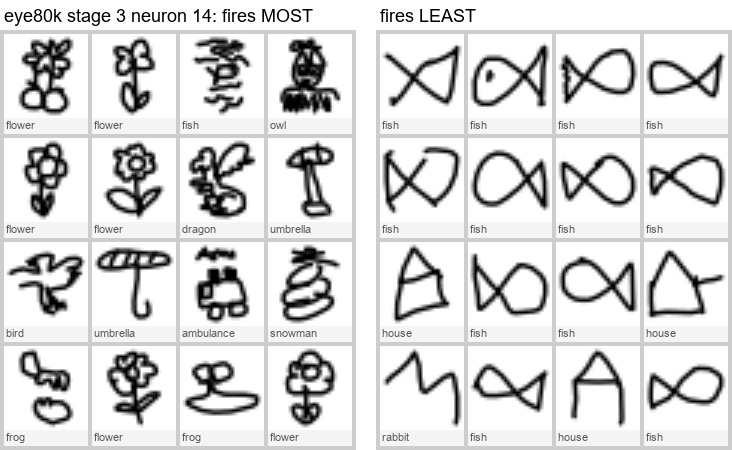

**Neuron 201: round bodies against pointy umbrellas.** "Round bodies with little parts sticking out" (3/4): frogs, teapots and fish. Its other side: "Umbrellas with pointed tops and handles" (4/4).

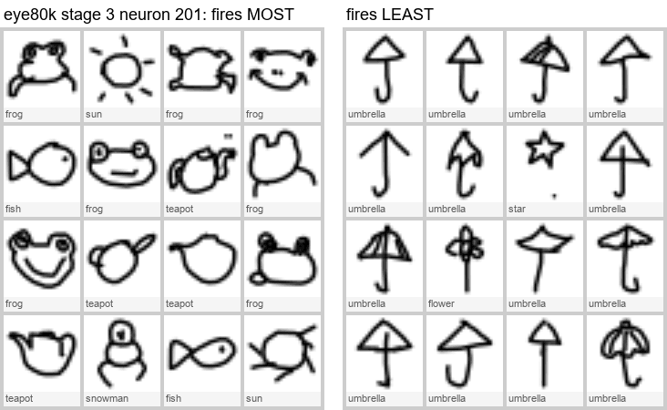

**Neuron 247: stars against snowmen.** "Five-pointed stars" (4/4). Its other side: "Stacked round shapes like snowmen" (3/4). Pointy against round, the opposite-poles pairing the essay showed with V against O.

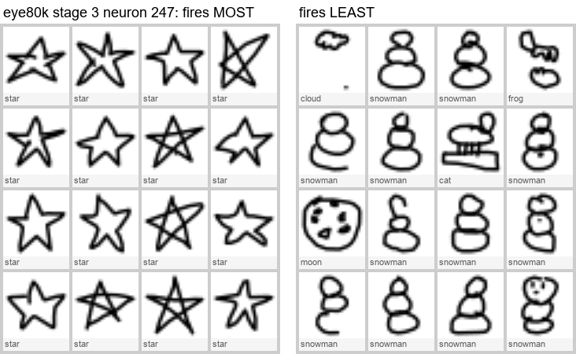

**Neuron 93: snowmen.** "Stacked round shapes like little snowmen" (4/4). Its other side: "Thin, open lines and curves" (4/4): birds drawn as a single "v", and umbrellas.

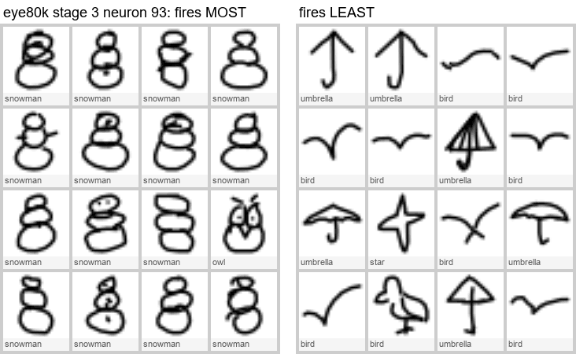

**Neuron 246: a full circle, and a labeler miss.** "Mostly round, closed outlines" (4/4): full moons. The other side is plainly flat, scribbly dragons and birds. The labeler wrote "Small, sideways shapes with bumps or points", and the scorer got 0/4 (the trial shown above).

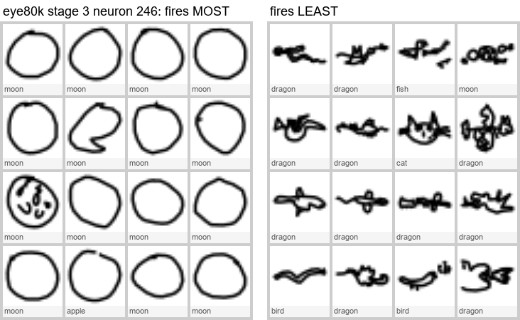

**Neuron 68: crescents and arches.** "Curved, open shapes like crescents and arches" (4/4): moons, rainbows and house roofs. Its other side: "Small, busy shapes stretched out sideways" (3/4): dragons.

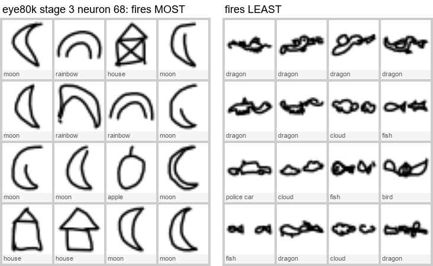

**Neuron 131: battlements.** "Castle walls with square battlements" (4/4). Its other side: "Upright figures with round, stacked bodies" (2/4).

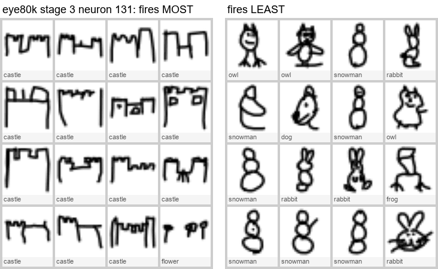

**Neuron 238: a hard one.** "Bold, dark doodles with lots of strokes" (2/4); its other side: "Thin, simple doodles with lots of empty space" (2/4). Looking at it, the top side is closed outlines with straight edges and corners (houses, stars, cats, owls). The bottom side is loose, open curves, mostly dog faces with floppy ears. It may be one idea (closed and cornered against open and floppy), but neither label caught it. Counted as two failures.

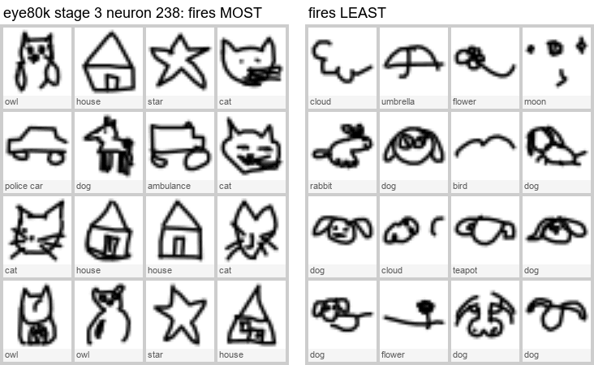

**From the 23k eye, neuron 3: pointy against stems.** "Things with pointy edges or rays" (4/4): suns, cats, stars and castles. Its other side: "Big tops on thin stems" (4/4): flowers, trees and umbrellas. Even the smallest eye has neurons like this.

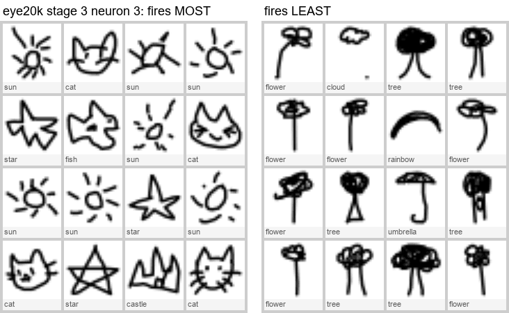

## Growth stories (eye80k)

**How settled are the jobs?** For each snapshot: the mean share of each neuron's final top-100 drawings that are already in its top-100 at that snapshot.

| Step | 307 | 609 | 1,206 | 2,387 | 3,359 | 4,727 | 6,652 | 9,360 (end) |
|---|---:|---:|---:|---:|---:|---:|---:|---:|
| Held-out accuracy | 54% | 70% | 78% | 84% | 85% | 86% | 88% | 88% |
| Top-100 already in place | 5% | 8% | 13% | 26% | 40% | 59% | 80% | 100% |

eye20k and eye300k are nearly the same (39% and 40% in place at step 3,359). The net is good long before its neurons' jobs are fixed. The jobs firm up as the learning rate cools. A scrubber should spend most of its length on the second half of training.

**Rough story counts from class shares** (all 256 eye80k neurons; these rules can't see shape jobs, so treat them as candidates):
- **kept** (the final main class leads from early on): 25;
- **narrowed** (spread over many classes, then one): 21;
- **offshoots** (main class early, other classes join later): 9;
- **changed** (a different class led, at half or more, after the net was already 60% right): 146;
- no clear story: 55.

"Changed" overcounts real job changes, because two classes can share a shape (a castle's and a house's roof). Still, many neurons do switch.

**The vision model's reading** of 8 picked neurons, each shown its top-8 at steps 155, 433, 1,206, 3,359 and 9,360: 3 "narrowed", 5 "changed", 0 "offshoots". The offshoots that exist sit just below the top 8, as the end-of-training top-32 panels show.

**Neuron 104: trees from the start.** gpt-6-luna: "Upright shapes with broad tops and narrow bottoms → Trees with leafy tops and visible trunks → … → Small leafy trees with rounded crowns" (narrowed). Trees already fill most of its top 8 at step 155, when the net was only 32% right. By the end, birds, sheep, a dog and an umbrella sit at ranks 6–29: fluffy or wide tops on thin legs.

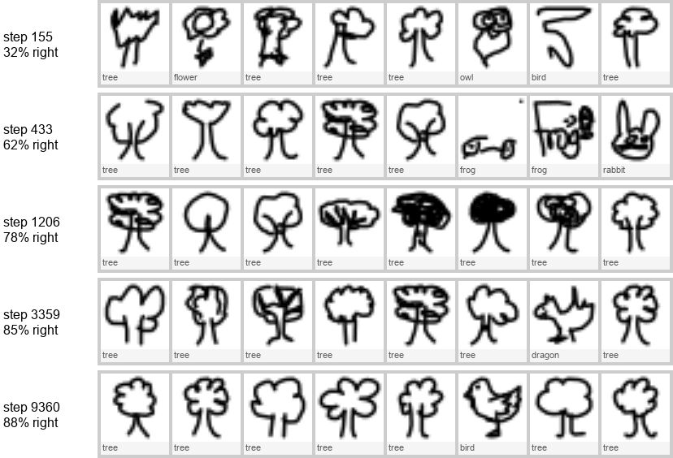
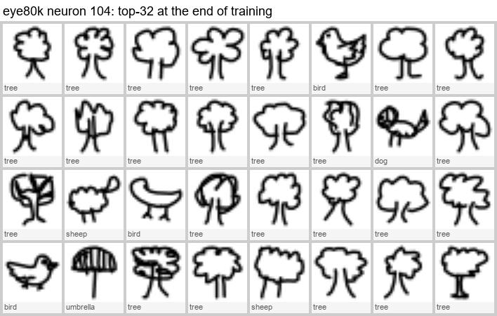

**Neuron 117: a roof that grows an umbrella offshoot.** gpt-6-luna: "no pattern → things with a pointed or raised top → simple houses with peaked roofs and doors → simple buildings with peaked roofs → boxy house shapes with peaked roofs" (narrowed). By the end, umbrellas (peaked canopies) hold 21% of its top-100, from rank 9 down. They were under 3% when the house job formed at step 609. This is the closest match to the essay's recursive generalization.

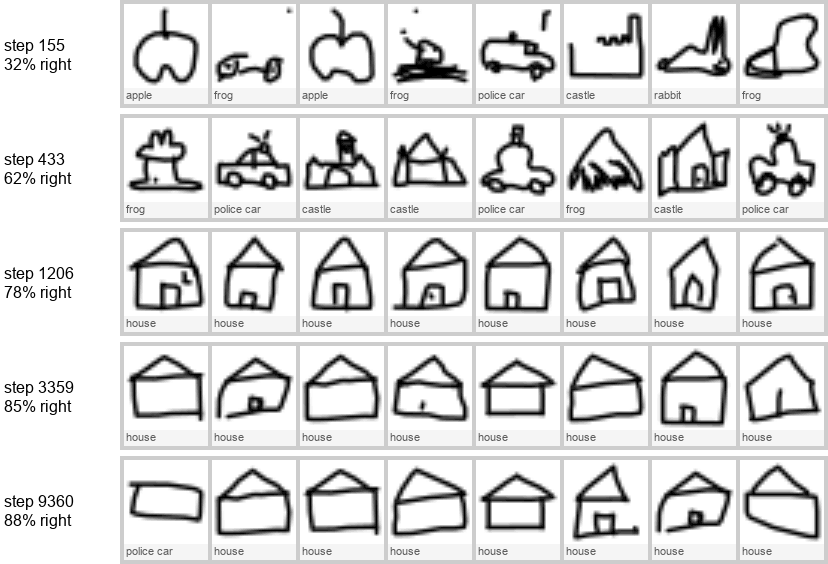
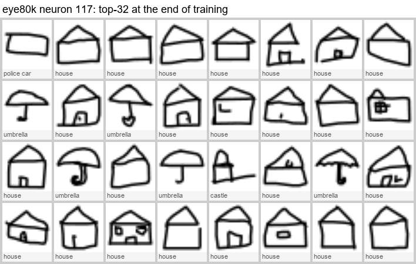

**Neuron 79: umbrellas, then pointy umbrellas, then stars.** gpt-6-luna: "no pattern → no pattern → Umbrellas with varied canopy shapes → Umbrellas, some with curved handles → Mostly umbrellas" (it said "changed"; to my eye it emerged and then narrowed). By the end the canopies are sharp arrows, and stars (pointy tips) hold 18% of its top-100.

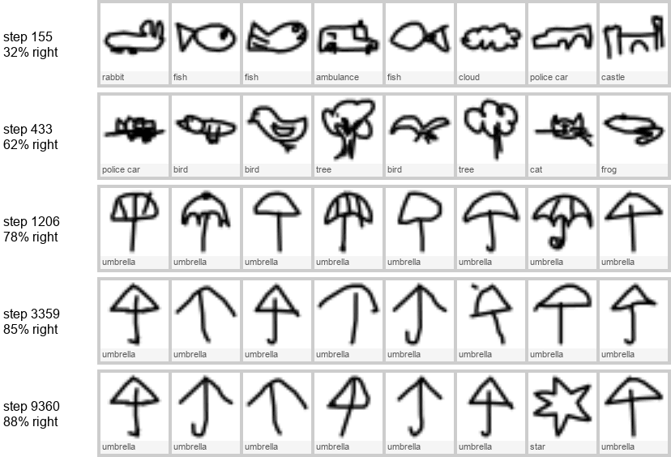
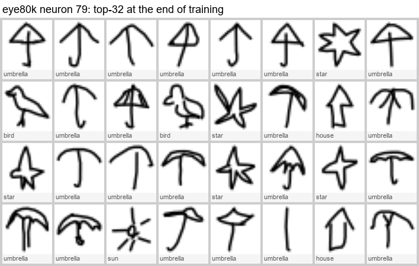

**Neuron 2: castle walls → fish.** gpt-6-luna: "Boxy outlines with raised or notched tops → Castle walls with battlements → Castle walls with battlements → Fish with loop-shaped bodies and pointed tails → Fish…" (changed). The job flips between steps 1,206 and 3,359, while the net is already 78–85% right.

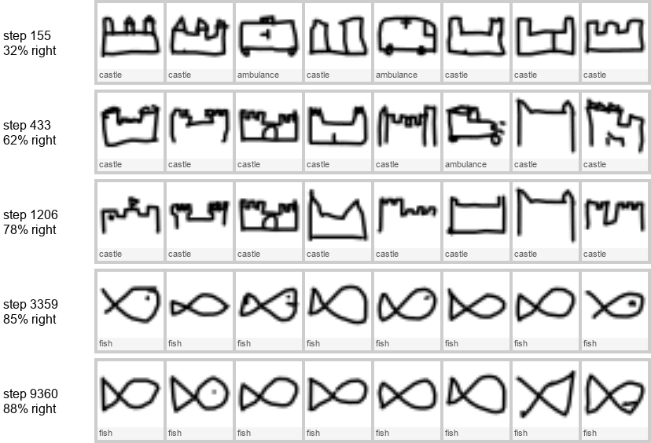

**Neuron 16: vehicles → arches → houses.** gpt-6-luna: "Mostly boxy wheeled vehicles → Puffy, bumpy shapes, often sheep-like → Mostly arch-shaped curves → Rainbow-like arches → Mostly simple house outlines" (changed). It is a rainbow neuron at 85% accuracy, and a tall-house neuron at the end.

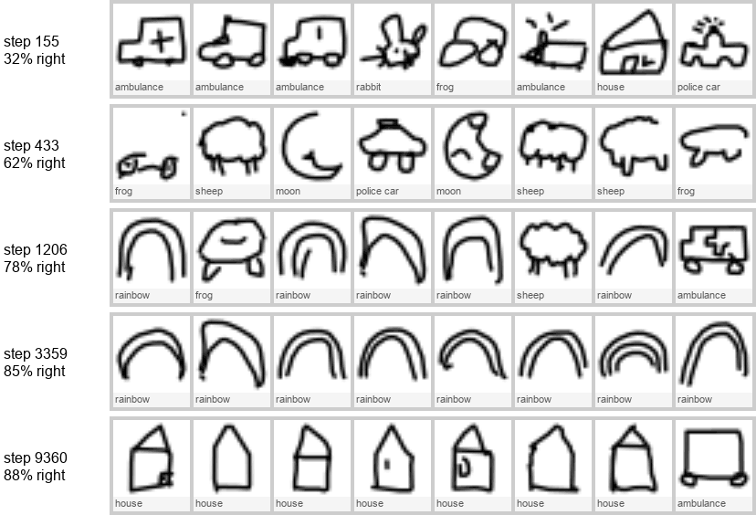

In the 23k eye the same kinds of stories show. Neuron 107 goes from plain circles (moons) at step 219 to stacked circles (snowmen). Neuron 2 goes from flat cars with a bump to a single arch (rainbows).

## Bigger eyes

*Added later on 2026-10-30, once the Experts room's trainings had finished.* The question: do neurons get cleaner above 311k parameters?

Two more eyes, same recipe as the others: 20 epochs, batch 512, AdamW at 3e-3, label smoothing 0.1, 20 log-spaced snapshots, 4× hidden channels, and the 15% memory cap.

| Run | Widths per stage | Parameters | Last-stage neurons | Held-out accuracy | Training time (shared GPU) |
|---|---|---:|---:|---:|---:|
| eye1m | 96, 192, 256 | 1,203,192 | 1,024 | 91.4% | 65 min |
| eye3m | 160, 320, 448 | 3,476,216 | 1,792 | 91.4% | 106 min |

**Cleanliness does not rise.** These are the free checks from above, on all neurons at the final snapshot:

| Run | Purity, stage 1 | Stage 2 | Stage 3 (the last) | Last-stage poles ≥75% pure | ≥50% pure | Effective classes in the top 16 / 100 / 500 ("fires most") | Classes a neuron strongly answers to |
|---|---:|---:|---:|---:|---:|---|---:|
| eye20k | 0.37 | 0.42 | 0.593 | 35% | 61% | 3.2 / 5.0 / 7.7 | 3.11 |
| eye80k | 0.33 | 0.44 | 0.583 | 32% | 61% | 3.1 / 4.6 / 7.1 | 3.25 |
| eye300k | 0.35 | 0.44 | 0.595 | 33% | 62% | 2.9 / 4.5 / 7.1 | 3.23 |
| eye1m | 0.35 | 0.45 | 0.585 | 32% | 62% | 2.9 / 4.4 / 7.0 | 3.46 |
| eye3m | 0.34 | 0.48 | 0.574 | 30% | 59% | 3.1 / 4.7 / 7.4 | 3.26 |

- **The bar, set before looking:** "clearly cleaner" meant a last-stage mean purity of at least 0.65 (the band tops out at 0.60), or at least 40% of last-stage poles 75% pure (the band tops out at 35%).
- **Results:** eye1m is inside the band (0.585 and 32%). eye3m is at its bottom edge (0.574 and 30%).
- **Breadth is flat too:** about 3 effective classes in a pole's top 16, and about 3.3 kinds of thing each neuron strongly answers to, at every size.
- **150 times the parameters, from 23k to 3.5M, and the last-stage neurons stay just as clean.** A bigger eye spends its size on more neurons of the same kind, not on sharper ones.
- **One small exception:** eye3m's middle stage (7×7) is a little purer (0.48 and 20% of poles ≥75% pure, against 0.42–0.45 and 10–16%). That stage's neurons see parts, and a mean over the grid suits them poorly (see Caveats). The difference is small, and the room's lessons are about the last stage.
- **So no labeling was done.** The plan was to run the gpt-6-luna distractor test on 64 neurons per new size only if purity rose clearly. It didn't, so no calls were made; the call count stays at 696. At the three smaller sizes the pass rate followed purity closely: pure poles pass about 90% of the time, spread poles 35–42%. With the same purity, the pass rate would likely land near 60% again.

**What the extra size buys is accuracy, and it levels off by 1.2M.**
- **Overall:** 88.3% → 90.3% → 91.4% → 91.4% (eye80k, eye300k, eye1m, eye3m).
- **The gains are on the hardest kinds** (eye80k → eye1m): frog 64% → 76%, bird 70% → 80%, cat 79% → 85%, dragon 75% → 80%, dog 73% → 78%.
- **The usual mix-ups barely move:** ambulance/police car, dragon/bird and cat/dog are still the top three at every size.

**What a bigger eye would cost in the room.** Times are for one look, the forward pass with every stage's neurons, as the room's worker does it. They come from [src/eye.js](../../src/eye.js) on one thread of this desktop's Xeon W-2223 under Node 24, as the median of three passes over 100 sample doodles. Float16 weights kept float32's top guess on 250 of 250 sample doodles at every size.

| Eye | Float16 weights (gzipped) | One look | Card sweep over the 5,000-doodle sample (6 helpers) | Sweep table | Growth recording (19 snapshots + summaries) |
|---|---:|---:|---:|---:|---:|
| eye80k (shipped) | 0.17 MB (0.15) | 5.5 ms | about 10 s (measured) | 11 MB | 3.8 MB (shipped) |
| eye300k | 0.62 MB (0.57) | 16 ms | about 30 s | 22 MB | 13 MB |
| eye1m | 2.4 MB (2.2) | 49 ms | about 1.5 min | 44 MB | 48 MB |
| eye3m | 7.0 MB (6.4) | 145 ms | about 4.5 min | 74 MB | 137 MB |

The sweep times for the bigger eyes are scaled from eye80k's measured 10 s by the time per look. Phones are slower.

**Is a bigger eye worth offering?**
- **Not as the default, and not to teach "bigger is cleaner".** These eyes are not cleaner.
- **eye3m is never worth it.** It is no more accurate than eye1m, at three times the cost.
- **eye1m could be an optional "bigger eye" button,** if the room wants this lesson: "a bigger eye guesses better (look at frogs), but its neurons aren't any cleaner; it just has more of them."
  - It would cost a 2.4 MB download on request, and about 50 ms per look, which still feels live while drawing.
  - Its card sweep would take about a minute and a half, and there would be 1,024 last-stage neurons to browse.
  - Leave out its growth recording (48 MB).
- **The room's default stays eye80k.** Whether to add the button is Ken's call.

The two new eyes' weights (float32, with manifests that [src/eye.js](../../src/eye.js) reads) are in `C:\Users\toont\tm-data\eye\export-eye1m\` and `export-eye3m\`.

## What this means for the room

- **Build it, with eye80k.** 88% accurate, 331 KB of float32 weights (or 165 KB as float16), 256 last-stage neurons.
- **The cards will work.** Many neurons have crisp, kid-nameable jobs, and plenty are shapes rather than classes ("two tall points", "lines sticking out", "a top on a stem", "crossed loops"). That is the essay's main lesson, and the doodles show it well.
- **Show both poles, always.** About half of the negative poles have a findable job, and some neurons' clearest job is on the negative side.
- **Honest copy:**
  - say "most neurons have one main job you can name", not "almost all";
  - say "squeeze it, and each neuron has to cover more kinds of things", not "its neurons get muddled";
  - don't say "bigger eyes are cleaner";
  - for the scrubber: "neurons try jobs, settle late, and sometimes switch; a few grow offshoots (a roof neuron picks up umbrellas)".
- **A challenge idea from the data:** "Find the neuron that thinks cat ears and castle towers are the same thing" (neuron 85).
- **Phase 1 notes:**
  - The bitmaps scale the drawing so its longer side spans 26 of the 28 pixels (a 1-pixel margin), centered on the shorter side, with soft strokes about 2 pixels wide. About 27% of pixels have some ink. The draw pad must match this.
  - The sample set is 1.36 MB zipped, more than the plan's 1 MB guess. The doodles' grays don't compress much; keeping only 4 gray levels would shrink it, if needed.

## Caveats

- **One labeler, one scorer, one trial per pole.** Verdicts flip a quarter of the time on a retest, but the rates hold. The labeler misreads some tiny doodles, so the pass rates are floors.
- **The distractor test is strict:** 3 of 4 from 16, with 12 random distractors. A label like "animals" fails, even if the neuron really is about animals, because random distractors include animals too.
- **Samples.** 64 neurons per size gives about ±8 points; the squeezes have only 16 poles each.
- **Neuron value = mean over the grid.** That suits the last stage (4×4, where every position sees the whole drawing), but not stages 1–2, whose neurons are local stroke detectors. Those stages were only measured by class purity.
- **Unrecognized drawings** are in the data, which costs a few points of accuracy and makes some top-16 grids messier.
- **The GPU was shared** with the Experts room run, so the training times are slow, not representative.

## Reproduce

Run Python with `-I`. The jlens venv was used read-only, and no packages were installed.

```bash
PY=/c/Users/toont/Documents/GitHub/jlens-tinystories/.venv/Scripts/python.exe
$PY -I tools/eye/download.py
$PY -I tools/eye/train.py --name eye20k --widths 12,24,32
$PY -I tools/eye/train.py --name eye80k --widths 24,48,64
$PY -I tools/eye/train.py --name eye300k --widths 48,96,128
$PY -I tools/eye/train.py --name eye80k-sq8 --widths 24,48,8 --hidden 96,192,8
$PY -I tools/eye/train.py --name eye80k-sqmlp8 --widths 24,48,64 --hidden 96,192,8
$PY -I tools/eye/train.py --name eye1m --widths 96,192,256       # Bigger eyes
$PY -I tools/eye/train.py --name eye3m --widths 160,320,448
$PY -I tools/eye/probe.py eye20k eye80k eye300k eye80k-sq8 eye80k-sqmlp8 eye1m eye3m
$PY -I tools/eye/label.py neurons eye80k          # likewise each run
$PY -I tools/eye/label.py neurons eye80k --retest 32
$PY -I tools/eye/label.py growth eye80k --neurons 104,79,117,2,16,5,115,25 --ckpts 7,10,13,16,19
$PY -I tools/eye/figures.py growth eye80k --strips 104,117,2,16,79 --ckpts 7,10,13,16,19
$PY -I tools/eye/figures.py cards eye80k 0,6,14,68,85,93,118,131,201,238,246,247
$PY -I tools/eye/summarize.py eye20k eye80k eye300k eye80k-sq8 eye80k-sqmlp8
$PY -I tools/eye/breadth.py eye20k eye80k eye300k eye80k-sq8 eye80k-sqmlp8 eye1m eye3m
$PY -I tools/eye/export.py eye1m --weights-only --device cpu --out C:/Users/toont/tm-data/eye/export-eye1m   # likewise eye3m
$PY -I tools/eye/figures.py cards eye80k-sq8 5,7
$PY -I tools/eye/export.py eye80k
```

## Files

Under `C:\Users\toont\tm-data\eye\` (not in the repo):
- `quickdraw24.npz` (data);
- `runs/<run>/` (20 snapshots each, `meta.json`, `probe.json`, `poles.npz`, `growth.npz`, `growth-summary.json`, `breadth.json`);
- `labels/` (every label, score and image the labeler saw, plus `calls.json`).

The export for Phase 1 is in `C:\Users\toont\tm-data\eye\export\`:

| File | Size | What |
|---|---:|---|
| `tiny-eye.json` | 9 KB | manifest: config, classes, tensor names/shapes/offsets, architecture and input notes, snapshot list, attribution |
| `tiny-eye.bin` | 331 KB | eye80k final weights, float32 little-endian |
| `checkpoints/*.bin` | 20 × 165 KB | all 20 snapshots, float16, same layout (for the Phase 2 scrubber) |
| `sample.bin` | 3.92 MB | 5,000 held-out doodles (208–209 per class), uint8 28×28, ink = 255 |
| `sample.json` | 87 KB | their classes, held-out indices, and row numbers in Google's files |
| `sample.zip` | 1.36 MB | the two sample files, zipped |
| `parity.json` | 580 KB | the first 100 sample doodles' logits and last-stage neuron values, from PyTorch in float32 on the CPU, for the JS parity test |

Reloading `tiny-eye.bin` from the manifest alone reproduces the PyTorch outputs, and gives 88.0% on the 5,000-doodle sample.
